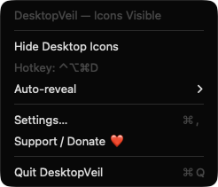
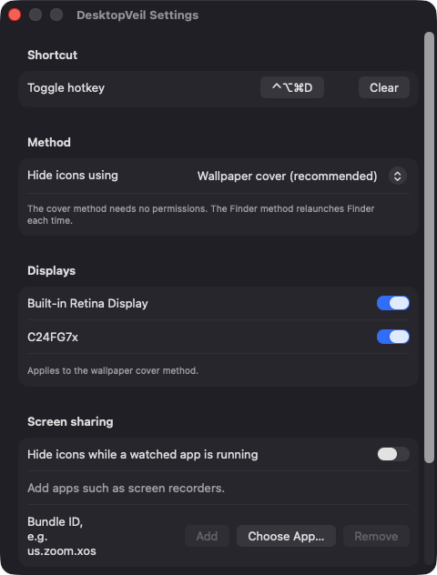
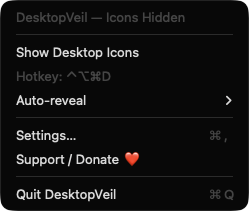

# DesktopVeil

**🌐 Website:** [turhe123.github.io/desktop-veil](https://turhe123.github.io/desktop-veil/)

Hide every desktop icon with one click or hotkey for clean screenshots, recordings and screen sharing.


## Why

DesktopVeil is a free, open-source, 100% native, backend-free alternative to paid utilities in the *Menu Bar Utility* category. It was inspired by Camouflage ($14.99 one-time), which showed there is real demand for a clean, reliable "hide my desktop" toggle. DesktopVeil has no accounts, no network access and no analytics. It is a small SwiftUI/AppKit app that lives in your menu bar.

## Features

- **One-click toggle** from the menu bar (*Hide Desktop Icons* / *Show Desktop Icons*). The menu bar icon and the menu title show the current state.
- **Global hotkey** (default `⌃⌥⌘D`), registered through Carbon `RegisterEventHotKey`. Record your own in Settings, or clear it.
- **Two hiding methods**
  - **Wallpaper cover (default):** a borderless window per display, placed just above the desktop icon level, draws your current wallpaper over the icons. Finder is not touched and no permissions are needed.
  - **Finder preference:** sets Finder's `CreateDesktop` preference to false and relaunches Finder. The setting is restored when you quit.
- **Wallpaper handling:** follows each display's wallpaper scaling (fill, fit, stretch, center), falls back to the wallpaper fill color for solid colors, and re-reads the wallpaper when Spaces or displays change and once a minute for rotating wallpapers.
- **Per-display control:** choose which displays get covered (cover method).
- **Auto-reveal:** show icons again after 5 minutes, 15 minutes or 1 hour (or never).
- **Hide while screen sharing:** automatically hide icons while any app on an editable list of bundle identifiers is running (for example Zoom or a screen recorder), and reveal them when the last one quits. Add apps by bundle ID or with a file picker.
- **Crash recovery:** if the app quit uncleanly in Finder mode, the next launch offers to restore your icons.
- **Launch at login** via `SMAppService`.
- Cover windows stay out of the window-cycling order and do not take focus when clicked.
- Menu bar only (no Dock icon) and a built-in *Support / Donate ❤️* button.

## Screenshots

<p align="center"></p>

<p align="center"><em>The DesktopVeil menu bar menu: hide desktop icons in one click, see the global hotkey, and set an auto-reveal timer.</em></p>

<p align="center"></p>

<p align="center"><em>Settings let you record the toggle hotkey, choose the hiding method, pick which displays to cover, and auto-hide while screen-sharing apps run.</em></p>

<p align="center"></p>

<p align="center"><em>With icons hidden, the menu shows the current state and offers Show Desktop Icons to bring them back.</em></p>

## Install

1. Download `DesktopVeil-macOS.zip` from the [latest release](https://github.com/turhe123/desktop-veil/releases/latest).
2. Unzip it and move `DesktopVeil.app` to `/Applications`.
3. The app is open source and not notarized, so clear the quarantine attribute:

   ```bash
   xattr -cr /Applications/DesktopVeil.app
   ```

4. The first time, right-click the app and choose **Open**.

Requires macOS 14.0 or later.

## Build from source

```bash
brew install xcodegen
xcodegen generate
xcodebuild -project DesktopVeil.xcodeproj -scheme DesktopVeil -configuration Release -derivedDataPath ./build build
```

The app is produced at `build/Build/Products/Release/DesktopVeil.app`.

## Permissions

DesktopVeil does not request Accessibility, Screen Recording, Microphone, Camera or any other privacy permission. The code uses none of the APIs that would require them:

- **Global hotkey:** Carbon `RegisterEventHotKey` needs no Accessibility permission.
- **Wallpaper cover:** only reads the wallpaper path and options through `NSWorkspace`. It does not capture the screen.
- **Watched apps:** only reads the list of running apps and their bundle identifiers. It does not record or inspect them.
- **Finder method:** writes Finder's `CreateDesktop` preference and relaunches Finder.
- **Launch at login:** uses `SMAppService`. macOS may list DesktopVeil under *System Settings › General › Login Items*.

If your wallpaper lives in a protected folder, macOS may ask for file access once.

## Support ❤️

DesktopVeil is free and always will be. If it saves you time, you can help keep the work going:

[Support Or (Leo) Davidai ❤️](https://ko-fi.com/leodavidai)

## License

MIT © Or Davidai Bachar
